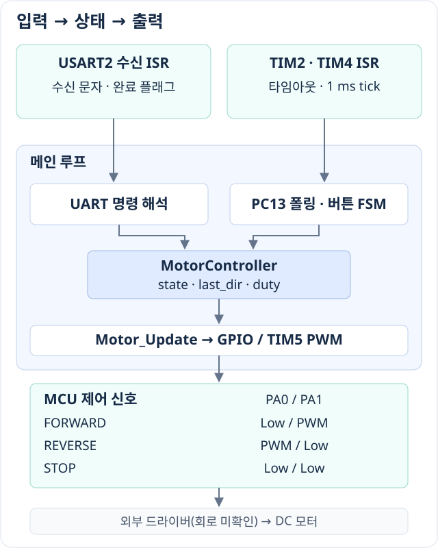

# STM32 DC Motor Controller

STM32F411RE의 두 제어 핀에 GPIO Low와 PWM을 선택적으로 적용해 DC 모터의 회전 방향과 듀티를 지정하는 펌웨어입니다.

**C · Bare-metal · CMSIS · GPIO · Timer/PWM · UART**

## H-bridge 관점의 방향·PWM 제어

한 입력을 Low로 유지하고 다른 입력에 PWM을 주며, PWM을 적용할 핀을 바꿔 방향을 전환합니다. **두 입력으로 제어하는 H-bridge 드라이버의 구동 패턴과 대응하는 구현**입니다. 실제 드라이버 모델·내부 회로는 확인되지 않았으며, 아래는 [코드로 확인한 MCU 출력](motor.c)입니다.

| 동작 상태 | PA0 | PA1 |
| --- | --- | --- |
| FORWARD | Low | PWM |
| REVERSE | PWM | Low |
| STOP | Low | Low |

PWM은 **20 kHz**, 듀티는 **50~90%·5% 간격**으로 설정합니다. 버튼과 UART로 상태·듀티를 변경하며, 정지 후에는 마지막 방향으로 재시작할 수 있습니다. H-bridge 원리와 코드의 대응은 [설계 문서](docs/design.md#1-h-bridge-제어-패턴과-하드웨어)에 설명했습니다.

## 핵심 구현과 구조

- **방향별 출력 전환:** 두 핀을 GPIO Low로 전환한 뒤 tick 대기·CCR 설정·GPIO/AF 전환을 거쳐 방향별 PWM을 적용합니다.
- **상태와 입력 처리 분리:** ISR은 수신 문자·시간·타임아웃을 전달하고, 메인 루프가 버튼·UART 입력을 해석해 모터 상태를 갱신합니다.
- **타이머 역할 분리:** TIM2는 롱클릭, TIM4는 1 ms 시간 기준, TIM5는 PWM을 담당합니다. 방향별로 PA0·PA1을 GPIO Low 또는 PWM 출력으로 전환합니다.



## 빌드와 사용

Windows에서 **Arm GNU Toolchain 15.2.Rel1 / GCC 15.2.1**과 GNU Make로 빌드를 확인했습니다. [Makefile](Makefile)의 `TOOL_DIR`·`VERSION`을 설치 경로에 맞춘 뒤 저장소 루트에서 실행합니다.

```powershell
make -j1
```

`rom_0x08000000.elf`·`.bin`이 생성됩니다. 보드 기록은 ST-LINK와 STM32CubeProgrammer CLI를 준비한 후 `make run`으로 수행합니다. 이 명령은 연결된 MCU의 Flash를 기록하고 리셋합니다.

USART2 터미널은 **115200 bps · 8N1 · 흐름 제어 없음**으로 설정합니다. 명령은 한 글자씩 보내고 로그를 확인합니다.

| 입력 | 동작 |
| --- | --- |
| `F` / `R` / `S` | 정방향 / 역방향 / 정지 요청, 소문자도 허용 |
| `1`~`9` | 듀티 50~90% 설정. 정지 중에는 설정값만 변경 |
| 버튼 숏클릭 | 정지 중 마지막 방향으로 시작, 구동 중 반대 방향으로 전환 |
| 버튼 롱클릭 | 눌림 확정 후 3초 타임아웃으로 정지 요청 |

초기값은 STOP·마지막 방향 FORWARD·듀티 50%입니다. 핀 구성과 출력 전환 조건은 [설계 문서](docs/design.md)를 참고하세요.

## 검증 범위

전체 펌웨어 빌드와 호스트 환경의 명령·버튼 상태 전이 검사를 통과했습니다. 호스트 검사는 GPIO·타이머를 대체한 로직 검사입니다.

PWM 듀티를 지정하는 개방루프 제어이며 RPM 피드백은 없습니다. 실제 배선·PWM 파형·회전·정지 시간은 이번 검토에서 확인하지 않았습니다. UART 수신과 정지 처리의 제약을 포함한 상세 내용은 [설계·검증·구현 한계](docs/design.md)에 정리했습니다.
